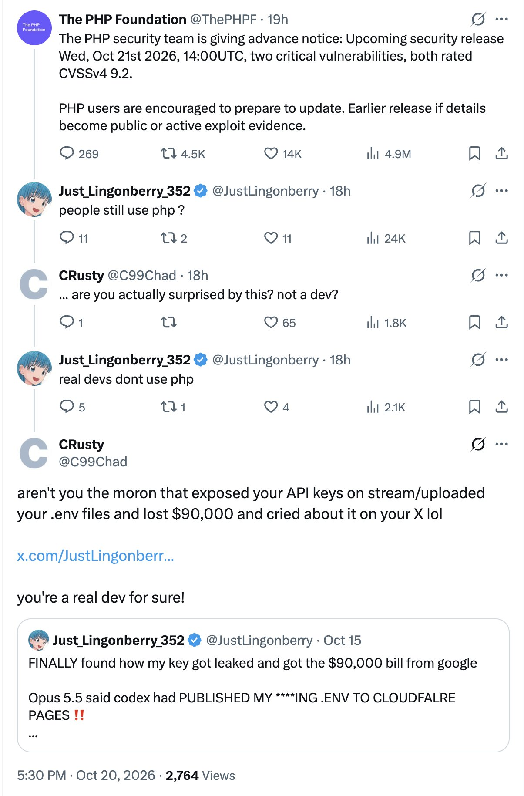
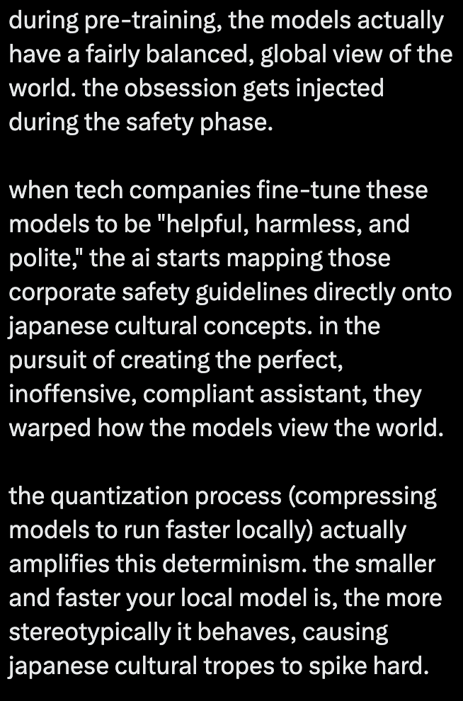

# Hello, everyone! 👋 {background-color="#1B3A6B"}

# Brief recap 📚 {background-color="#1B3A6B"}

## The AI module

:::{style="margin-top: 60px; font-size: 24px;"}
:::{.columns}
:::{.column width="50%"}
- Last class we built a [retrieval-augmented generation]{.alert} (RAG) pipeline
- The pipeline has five stages: [chunk → embed → store → retrieve → generate]{.alert}
- [Fine-tuning]{.alert} changes the model's weights, while RAG changes its context
- Fine-tuning is for behaviour and style, and RAG is for facts that change
- Try the options in this order: [prompt → RAG → fine-tune]{.alert}
- Only move on when the previous option does not work
:::

:::{.column width="50%"}
:::{style="background: rgba(27, 58, 107, 0.08); padding: 18px; border-radius: 10px; font-size: 22px; margin-top: 10px;"}
**Today we move to the cloud**

- So far, all the computers we used were [yours]{.alert}
- Today we rent [someone else's]{.alert} computer from AWS
- You will control it from your terminal
:::
:::
:::
:::

## Lecture overview
### What we will cover today

:::{style="margin-top: 20px; font-size: 24px;"}
:::{.columns}
:::{.column width="55%"}
- We start with the money: owning servers versus renting them
- Two stories: Animoto and The Washington Post
- Then the vocabulary: [IaaS, PaaS, SaaS, FaaS]{.alert} and virtual machines
- A tour of AWS: compute, storage, and databases
- [The October 2025 outage]{.alert}, when AWS broke for fifteen hours
- You open an account and set a budget that emails you
- We read a scanned document with [Amazon Textract](https://aws.amazon.com/textract/)
:::

:::{.column width="45%"}
:::{style="text-align: center;"}
[{width="100%"}](#){data-modal-type="image" data-modal-url="figures/aws-regions-2026.png"}

:::{style="font-size: 20px;"}
AWS lists [123 availability zones in 39 regions](https://aws.amazon.com/about-aws/global-infrastructure/). The one that failed in October 2025 is on this page
:::
:::
:::
:::
:::

## Tweet of the day

:::{style="text-align: center; margin-top: 10px;"}
[{height="520px"}](#){data-modal-type="image" data-modal-url="figures/env-tweet.jpeg"}

:::{style="font-size: 18px;"}
Source: [X](https://x.com/digitalshane_/status/2112934189788283088)
:::
:::

## Paper of the day

:::{style="margin-top: 10px;"}
:::{.columns}
:::{.column width="50%"}
:::{style="text-align: center;"}
[{height="480px"}](#){data-modal-type="image" data-modal-url="figures/japan-paper.png"}
:::
:::

:::{.column width="50%"}
:::{style="text-align: center;"}
[{height="480px"}](#){data-modal-type="image" data-modal-url="figures/japan-paper-thread.png"}
:::
:::
:::

:::{style="text-align: center; font-size: 18px;"}
Source: [arXiv](https://arxiv.org/abs/2604.21751)
:::
:::

# Cloud computing ☁️ {background-color="#1B3A6B"}

## What is cloud computing?

:::{style="margin-top: 30px; font-size: 24px;"}
:::{.columns}
:::{.column width="50%"}
- Cloud computing is [renting computers over the internet]{.alert}
- You [pay as you go]{.alert}, often by the second
- The machine sits in someone else's data centre
- The "Big Three" are [AWS](https://aws.amazon.com/), [Microsoft Azure](https://azure.microsoft.com/), and [Google Cloud](https://cloud.google.com/)
  - Market share: AWS 28%, Azure 21%, Google 14% ([Synergy Research](https://www.srgresearch.com/articles/cloud-market-annual-revenue-run-rate-topped-half-a-trillion-dollars-in-q1-as-growth-surge-continues), Q1 2026)
  - Spending: [$129 billion]{.alert} in Q1 2026, up 35% in a year ([Synergy Research](https://www.srgresearch.com/articles/cloud-market-annual-revenue-run-rate-topped-half-a-trillion-dollars-in-q1-as-growth-surge-continues))
- AWS is Amazon's most profitable division
  - In Q2 2026: 21% of sales and 60% of operating profit ($16.6 billion, [Amazon](https://ir.aboutamazon.com/news-release/news-release-details/2026/Amazon-com-Announces-Second-Quarter-Results/default.aspx))
:::

:::{.column width="50%"}
:::{style="text-align: center;"}
[{width="100%"}](#){data-modal-type="image" data-modal-url="figures/amazon.png"}

Chart to Q3 2024: [GeekWire](https://www.geekwire.com/2025/amazons-quarterly-profits-soar-to-a-record-20-billion-but-cloud-growth-comes-up-short/). 2026 figures: [Amazon Q2 2026 results](https://www.aboutamazon.com/news/company-news/amazon-earnings-q2-2026-report)
:::
:::
:::
:::

# Why should we care about cloud computing? {background-color="#1B3A6B"}

## Imagine you are opening a business...
### Traditional approach

:::{style="margin-top: 30px; font-size: 28px;"}
:::{.columns}
:::{.column width="50%"}
1. Estimate supply and demand
2. Estimate infrastructural needs
3. Purchase and deploy infrastructure
4. Install and test your system
5. Offer your services to clients
:::

:::{.column width="50%"}
- Infrastructure is [very expensive]{.alert}: 
  - Hardware (Dell's [cheapest rack server](https://www.dell.com/en-us/shop/ipovw/poweredge-r360) starts at $5,549, and a good one costs much more)
  - Real estate costs 
  - Cooling system, power bill 
  - A few systems engineers 
  - Redundancy for high reliability
- It takes time to deploy the infrastructure
- [What if the estimations were wrong?]{.alert}
:::
:::
:::

## Imagine you are opening a business...
### Cloud approach
:::{style="margin-top: 30px; font-size: 28px;"}

1. Choose one or more cloud services providers
2. Deploy your systems on the cloud
3. Offer your services to clients
4. Pay for what you use

:::{style="margin-top: 40px;"}
:::

| **Traditional process**       | **With Cloud Computing**      |
|-------------------------------|-------------------------------|
| ❌ High investment risk       | ✅ Reduced risk               |
| ❌ Long time-to-market        | ✅ Shorter time-to-market     |
| ✅ Manages own data           | ❌ Trust the vendor?          |
| ✅ Completely in control      | ❌ Dependent on a specific vendor? |
:::

## Case study: Animoto

:::{style="margin-top: 30px; font-size: 26px;"}
:::{.columns}
:::{.column width="50%"}
- [Animoto](https://animoto.com/): Lets users create videos from their own photos/music
- Built using [Amazon EC2](https://aws.amazon.com/ec2/) (Elastic Compute Cloud) + [S3](https://aws.amazon.com/s3/) (Simple Storage Service) + [SQS](https://aws.amazon.com/sqs/) (Simple Queue Service)
- Released a Facebook app in mid-April 2008 
- More than 750,000 people signed up within 3 days
- EC2 usage went from [50 machines to 3,500]{.alert} (x70 scalability!)
- No way they could have done this with traditional infrastructure!
:::

:::{.column width="50%"}
:::{style="text-align: center;"}
[{width="100%"}](#){data-modal-type="image" data-modal-url="figures/animoto.jpg"}

Source: [Jeff Bezos' talk at Stanford in 2008](https://youtu.be/6nKfFHuouzA?si=M5LCwMxMUC5Ay3oY)
:::
:::
:::
:::

## Case study: The Washington Post

:::{style="margin-top: 60px; font-size: 23px;"}
:::{.columns}
:::{.column width="50%"}
- In 2008, [Hillary Clinton's White House schedule]{.alert} was made public
- It was [17,481 pages](https://www2.eecs.berkeley.edu/Pubs/TechRpts/2009/Archive/EECS-2009-28.pdf) of low-quality PDF, and none of it was searchable
- Reading it by hand would have taken hundreds of hours
- Peter Harkins, a senior engineer at the paper, wanted the data in the newsroom within the same news cycle
- He ran [optical character recognition (OCR)](https://en.wikipedia.org/wiki/Optical_character_recognition) software on 200 [EC2](https://aws.amazon.com/ec2/) instances
- The job took nine hours and 1,407 hours of machine time, and it cost [[$144.62](https://www.greenm3.com/gdcblog/2013/8/28/case-study-of-washington-post-using-aws.html)]{.alert}
- The searchable database went public 26 hours after that
:::

:::{.column width="50%"}
:::{style="text-align: center; margin-top: -20px;"}
[{width="100%"}](#){data-modal-type="image" data-modal-url="figures/wapo.png"}

Source: [The Washington Post](https://www.washingtonpost.com/archive/politics/2008/03/21/hillary-clinton-in-the-white-house/200a2e1f-efb4-469a-b5dd-05e87675b598/)
:::
:::
:::
:::

# Cloud computing services ☁️ {background-color="#1B3A6B"}

## Cloud computing services

:::{style="margin-top: 30px; font-size: 28px;"}
- [SaaS (Software as a Service)]{.alert}: a finished application, used through your browser
  - Someone else runs the updates, security, and maintenance
  - You pay a monthly or yearly subscription
  - Examples: [Gmail](https://gmail.com), [Microsoft 365](https://www.microsoft.com/microsoft-365), [Salesforce](https://www.salesforce.com), [GitHub Copilot](https://github.com/features/copilot)

:::{style="margin-top: 20px;"}
- [PaaS (Platform as a Service)]{.alert}: a place to run code you wrote
  - You supply the code. The platform supplies the servers
  - You pay for the platform, plus storage and bandwidth
  - Examples: [Google App Engine](https://cloud.google.com/appengine), [AWS Elastic Beanstalk](https://aws.amazon.com/elasticbeanstalk), [Render](https://render.com), [GitHub Actions/Codespaces/Pages](https://github.com/features/actions)
:::
:::

## Cloud computing services
### SaaS

:::{style="margin-top: 30px; font-size: 26px; text-align: center;"}
[{width="65%"}](#){data-modal-type="image" data-modal-url="figures/saas.jpg"}
:::

## Cloud computing services
### PaaS

:::{style="margin-top: 30px; font-size: 26px; text-align: center;"}
[{width="100%"}](#){data-modal-type="image" data-modal-url="figures/paas.png"}
:::

## Cloud computing services

:::{style="margin-top: 30px; font-size: 28px;"}
- [FaaS (Function as a Service)]{.alert}:
  - You run code without setting up or managing servers
  - You pay only for the time your function runs
  - Examples: [AWS Lambda](https://aws.amazon.com/lambda), [Google Cloud Run functions](https://cloud.google.com/functions), [Azure Functions](https://azure.microsoft.com/en-us/services/functions)

:::{style="margin-top: 20px;"}
- [IaaS (Infrastructure as a Service)]{.alert}:
  - You rent virtual machines, storage, and networking over the internet
  - You pay for the resources you use
  - Examples: [AWS EC2](https://aws.amazon.com/ec2), [Google Compute Engine](https://cloud.google.com/compute), [Azure Virtual Machines](https://azure.microsoft.com/en-us/services/virtual-machines)
:::
:::

## Cloud computing services
### FaaS

:::{style="margin-top: 30px; font-size: 26px; text-align: center;"}
[{width="70%"}](#){data-modal-type="image" data-modal-url="figures/faas.png"}
:::

## Cloud computing services
### IaaS

:::{style="margin-top: 30px; font-size: 26px; text-align: center;"}
[{width="70%"}](#){data-modal-type="image" data-modal-url="figures/iaas.png"}
:::

## Comparison of cloud services

:::{style="margin-top: 120px; font-size: 26px; text-align: center;"}
<table style="border-collapse: collapse; width: 90%; margin: 20px auto;">
  <tr>
    <th style="border: 1px solid #ddd; padding: 8px; text-align: center; background-color: #f2f2f2;">On-premise</th>
    <th style="border: 1px solid #ddd; padding: 8px; text-align: center; background-color: #f2f2f2;">IaaS</th>
    <th style="border: 1px solid #ddd; padding: 8px; text-align: center; background-color: #f2f2f2;">PaaS</th>
    <th style="border: 1px solid #ddd; padding: 8px; text-align: center; background-color: #f2f2f2;">SaaS</th>
  </tr>
  <tr>
    <td class="other-manages" style="border: 1px solid #ddd; padding: 8px; text-align: left; background-color: #f44336; color: white; text-align: center;">Application</td>
    <td class="other-manages" style="border: 1px solid #ddd; padding: 8px; text-align: left; background-color: #f44336; color: white; text-align: center;">Application</td>
    <td class="other-manages" style="border: 1px solid #ddd; padding: 8px; text-align: left; background-color: #f44336; color: white; text-align: center;">Application</td>
    <td class="other-manages" style="border: 1px solid #ddd; padding: 8px; text-align: left; background-color: #4CAF50; color: white; text-align: center;">Application</td>
  </tr>
  <tr>
    <td class="user-manages" style="border: 1px solid #ddd; padding: 8px; text-align: left; background-color: #f44336; color: white; text-align: center;">Middleware</td>
    <td class="user-manages" style="border: 1px solid #ddd; padding: 8px; text-align: left; background-color: #f44336; color: white; text-align: center;">Middleware</td>
    <td class="other-manages" style="border: 1px solid #ddd; padding: 8px; text-align: left; background-color: #4CAF50; color: white; text-align: center;">Middleware</td>
    <td class="other-manages" style="border: 1px solid #ddd; padding: 8px; text-align: left; background-color: #4CAF50; color: white; text-align: center;">Middleware</td>
  </tr>
  <tr>
    <td class="user-manages" style="border: 1px solid #ddd; padding: 8px; text-align: left; background-color: #f44336; color: white; text-align: center;">OS</td>
    <td class="user-manages" style="border: 1px solid #ddd; padding: 8px; text-align: left; background-color: #f44336; color: white; text-align: center;">OS</td>
    <td class="other-manages" style="border: 1px solid #ddd; padding: 8px; text-align: left; background-color: #4CAF50; color: white; text-align: center;">OS</td>
    <td class="other-manages" style="border: 1px solid #ddd; padding: 8px; text-align: left; background-color: #4CAF50; color: white; text-align: center;">OS</td>
  </tr>
  <tr>
    <td class="user-manages" style="border: 1px solid #ddd; padding: 8px; text-align: left; background-color: #f44336; color: white; text-align: center;">Virtualisation</td>
    <td class="user-manages" style="border: 1px solid #ddd; padding: 8px; text-align: left; background-color: #f44336; color: white; text-align: center;">Virtualisation</td>
    <td class="other-manages" style="border: 1px solid #ddd; padding: 8px; text-align: left; background-color: #4CAF50; color: white; text-align: center;">Virtualisation</td>
    <td class="other-manages" style="border: 1px solid #ddd; padding: 8px; text-align: left; background-color: #4CAF50; color: white; text-align: center;">Virtualisation</td>
  </tr>
  <tr>
    <td class="user-manages" style="border: 1px solid #ddd; padding: 8px; text-align: left; background-color: #f44336; color: white; text-align: center;">Servers</td>
    <td class="other-manages" style="border: 1px solid #ddd; padding: 8px; text-align: left; background-color: #4CAF50; color: white; text-align: center;">Servers</td>
    <td class="other-manages" style="border: 1px solid #ddd; padding: 8px; text-align: left; background-color: #4CAF50; color: white; text-align: center;">Servers</td>
    <td class="other-manages" style="border: 1px solid #ddd; padding: 8px; text-align: left; background-color: #4CAF50; color: white; text-align: center;">Servers</td>
  </tr>
  <tr>
    <td class="user-manages" style="border: 1px solid #ddd; padding: 8px; text-align: left; background-color: #f44336; color: white; text-align: center;">Networking</td>
    <td class="other-manages" style="border: 1px solid #ddd; padding: 8px; text-align: left; background-color: #4CAF50; color: white; text-align: center;">Networking</td>
    <td class="other-manages" style="border: 1px solid #ddd; padding: 8px; text-align: left; background-color: #4CAF50; color: white; text-align: center;">Networking</td>
    <td class="other-manages" style="border: 1px solid #ddd; padding: 8px; text-align: left; background-color: #4CAF50; color: white; text-align: center;">Networking</td>
  </tr>
</table>

User manages Provider manages

:::

## What is middleware?

:::{style="margin-top: 30px; font-size: 23px;"}
:::{.columns}
:::{.column width="50%"}
- Middleware is software that [connects two separate applications]{.alert}
- It sits between the operating system and the application
- We rarely see it, but most of the internet depends on it
- It handles authentication, encryption, and the drivers that talk to databases
- A [message queue]{.alert} holds work until a machine is free, so neither side waits for the other
- Animoto used [SQS](https://aws.amazon.com/sqs) that way: the queue held the video jobs while EC2 grew to 3,500 machines
- [Apache Kafka](https://kafka.apache.org) and [RabbitMQ](https://www.rabbitmq.com) do the same job outside AWS
:::

:::{.column width="50%"}
:::{style="text-align: center;"}
[{width="100%"}](#){data-modal-type="image" data-modal-url="figures/middleware.avif"}

More about middleware: <https://aws.amazon.com/what-is/middleware/>
:::
:::
:::
:::

## What is virtualisation?

:::{style="margin-top: 30px; font-size: 25px;"}
:::{.columns}
:::{.column width="50%"}
- Suppose Alice has a machine with 4 CPUs and 8 GB of memory, and three customers: 
  - Bob wants a machine with 1 CPU and 3 GB of memory 
  - Charlie wants 2 CPUs and 1 GB of memory 
  - Daniel wants 1 CPU and 4 GB of memory
- What should Alice do?
- Alice can sell each customer a [virtual machine (VM)]{.alert} with the requested resources
- From each customer's perspective, it appears as if they had a physical machine all by themselves ([isolation]{.alert})
:::

:::{.column width="50%"}
:::{style="text-align: center;"}
[{width="100%"}](#){data-modal-type="image" data-modal-url="figures/virtualisation.png"}

More about virtualisation: <https://aws.amazon.com/what-is/virtualization/>
:::
:::
:::
:::

# Amazon Web Services (AWS) {background-color="#1B3A6B"}

## Amazon Web Services (AWS)

:::{style="margin-top: 30px; font-size: 25px;"}
:::{.columns}
:::{.column width="50%"}
- AWS is a collection of cloud-based services
- It's a very large platform
- Let me say it again: [a VERY LARGE ONE]{.alert} 😂
- It offers services for:
  - Compute, storage, databases, analytics, machine learning, AI, IoT, security, and more
- Many companies use AWS, including [Netflix](https://aws.amazon.com/solutions/case-studies/innovators/netflix/), [Airbnb](https://aws.amazon.com/solutions/case-studies/airbnb-case-study/), and [NASA](https://www.earthdata.nasa.gov/engage/partnerships/aws-storage-cloud-compute-request)
- The most widely used services are [EC2](https://aws.amazon.com/ec2), [S3](https://aws.amazon.com/s3), and [RDS](https://aws.amazon.com/rds), for computing, storage, and databases, respectively
- Let's look at them in more detail
:::

:::{.column width="50%"}
:::{style="text-align: center;"}
[{width="100%"}](#){data-modal-type="image" data-modal-url="figures/aws.png"}

<https://aws.amazon.com>
:::
:::
:::
:::

## Amazon EC2 - Elastic Compute Cloud

:::{style="margin-top: 30px; font-size: 26px;"}
:::{.columns}
:::{.column width="50%"}
- EC2 rents you [virtual machines]{.alert}, called instances
- You can resize them whenever you need to
- Most run Linux, but other systems are available
- You control them with Bash from the command line
- A GUI exists, but you do not need it
- Uses: websites, databases, machine learning models
- <https://aws.amazon.com/ec2/>
:::

:::{.column width="50%"}
- Be [mindful of the costs!]{.alert} They add up quickly
- Billing is per second (or per hour)
- Not included: data transfer, persistent storage, and scaling

:::{style="text-align: center;"}
[{width="90%"}](#){data-modal-type="image" data-modal-url="figures/ec2meme.jpg"}
:::
:::
:::
:::

## EC2 auto scaling

:::{style="margin-top: 30px; font-size: 24px;"}
:::{.columns}
:::{.column width="50%"}
- Scaling means [adding or removing]{.alert} compute capacity
- You can scale by hand or automatically
- It helps with fluctuating workloads
- Example: a website that is busier during the day
- You set a [minimum, desired, and maximum]{.alert} number of instances
- AWS keeps the group inside those bounds
- A rule triggers the change, usually average CPU or request count
- Load balancers spread the traffic across the instances
:::

:::{.column width="50%"}
:::{style="text-align: center; font-size: 20px;"}
[{width="100%"}](#){data-modal-type="image" data-modal-url="figures/auto-scaling.png"}

<https://aws.amazon.com/autoscaling>
:::
:::
:::
:::

## ELB - Elastic Load Balancer

:::{style="margin-top: 30px; font-size: 24px;"}
:::{.columns}
:::{.column width="50%"}
- ELB [spreads incoming traffic]{.alert} across several instances
- It works in one availability zone or across several
- Auto scaling adds instances, and ELB sends traffic to them
- [Health checks]{.alert} run every few seconds
- A failing instance gets no traffic until it recovers
- ELB holds the HTTPS certificate, so the instances do not need one
- You pay for data transfer and requests. It can get expensive
:::

:::{.column width="50%"}
:::{style="text-align: center; font-size: 20px;"}
[{width="100%"}](#){data-modal-type="image" data-modal-url="figures/elb.png"}

<https://aws.amazon.com/elasticloadbalancing/>
:::
:::
:::
:::

## Cloud storage
### Amazon S3 - Simple Storage Service

:::{style="margin-top: 30px; font-size: 23px;"}
:::{.columns}
:::{.column width="50%"}
- AWS has three main storage services: [S3](https://aws.amazon.com/s3), [EBS](https://aws.amazon.com/ebs), and [EFS](https://aws.amazon.com/efs)
- S3 is [object storage]{.alert} for backups, archives, and analytics
- Files live in [buckets]{.alert}, the top-level containers of S3
- Each file is stored in at least three availability zones
- Durability is 99.999999999% (eleven nines!)
- Lifecycle policies move old data to cheaper storage classes
  - Standard, Intelligent-Tiering, and Glacier (Instant, Flexible, Deep Archive)
- Versioning keeps old versions of a file, like `git`
:::

:::{.column width="50%"}
:::{style="text-align: center; font-size: 20px;"}
[{width="100%"}](#){data-modal-type="image" data-modal-url="figures/s3.png"}

<https://aws.amazon.com/s3/>
:::
:::
:::
:::

## Cloud storage
### Amazon EBS - Elastic Block Store

:::{style="margin-top: 30px; font-size: 24px;"}
:::{.columns}
:::{.column width="50%"}
- EBS gives EC2 instances [block storage]{.alert}
- Block storage works like a hard drive
- EC2 formats it and runs its operating system on it
- S3 is different: it is object storage
- Object storage keeps whole files and their metadata, reached over the web
- Main use: the disk of an EC2 instance, for the system and databases
- [Snapshots]{.alert} back up a volume (like `git` again!)
- Up to 64 TiB per volume
:::

:::{.column width="50%"}
:::{style="text-align: center; font-size: 20px;"}
[{width="100%"}](#){data-modal-type="image" data-modal-url="figures/ebs.webp"}

<https://aws.amazon.com/ebs/>
:::
:::
:::
:::

## Amazon EFS - Elastic File System

:::{style="margin-top: 30px; font-size: 22px;"}
:::{.columns}
:::{.column width="50%"}
- EFS provides scalable file storage for EC2 instances
- It is mainly used for [shared file storage]{.alert}: many instances mount the same file system
- Common uses are big data, analytics, and web serving
- An EBS volume usually attaches to one instance at a time
- EFS grows and shrinks on its own, so there is no volume size to choose
- As with S3 and EBS, you pay for the storage you use
:::

:::{.column width="50%"}
:::{style="text-align: center; font-size: 20px;"}
[{width="50%"}](#){data-modal-type="image" data-modal-url="figures/efs.png"}

<https://aws.amazon.com/efs/>
:::
:::
:::
:::

## Database services
### Amazon RDS - Relational Database Service

:::{style="margin-top: 30px; font-size: 23px;"}
:::{.columns}
:::{.column width="50%"}
- [Amazon RDS](https://aws.amazon.com/rds/) runs a [relational database]{.alert} for you
- Seven engines: Aurora, PostgreSQL, MySQL, MariaDB, Oracle, SQL Server, and Db2
- AWS handles backups, patches, and updates
- You get a hostname and a port, but no `ssh`
- [Multi-AZ]{.alert} keeps a standby copy in another zone and switches to it on failure
- Related services:
  - [Athena](https://aws.amazon.com/athena/) runs SQL on files in S3, with no database server
  - [Redshift](https://aws.amazon.com/redshift/) is for data warehousing
  - [DynamoDB](https://aws.amazon.com/dynamodb/) is for NoSQL
:::

:::{.column width="50%"}
:::{style="text-align: center; font-size: 20px;"}
[{width="60%"}](#){data-modal-type="image" data-modal-url="figures/rds.png"}

<https://aws.amazon.com/rds/>
:::
:::
:::
:::

## Amazon SageMaker AI

:::{style="margin-top: 30px; font-size: 22px;"}
:::{.columns}
:::{.column width="50%"}
- Finally, let's talk about [Amazon SageMaker AI](https://aws.amazon.com/sagemaker/ai/)
- It is a managed service to build, train, and deploy [machine learning models at scale]{.alert}
  - AWS renamed the original service in December 2024, so older tutorials still say "SageMaker"
- It has pre-built containers for TensorFlow, PyTorch, and scikit-learn
- You can bring your own models and train them in Jupyter notebooks
- The [AWS Marketplace](https://aws.amazon.com/marketplace) sells many more models, and [SageMaker Unified Studio](https://aws.amazon.com/sagemaker/unified-studio/) is the single workbench for data and AI projects
- Some ready-made AI services:
  - [Comprehend (for NLP)](https://aws.amazon.com/comprehend/)
  - [Rekognition (Visual Analysis)](https://aws.amazon.com/rekognition/)
  - [Translate](https://aws.amazon.com/translate/)
  - [Polly (text-to-speech)](https://aws.amazon.com/polly/)
:::

:::{.column width="50%"}
:::{style="text-align: center; font-size: 20px;"}
[{width="100%"}](#){data-modal-type="image" data-modal-url="figures/sagemaker.png"}

<https://aws.amazon.com/sagemaker/>
:::
:::
:::
:::

## When AWS has a bad night
### 19 October 2025, us-east-1

:::{style="margin-top: 20px; font-size: 23px;"}
:::{.columns}
:::{.column width="50%"}
- Two DynamoDB programs updated the same [Domain Name System (DNS)](https://en.wikipedia.org/wiki/Domain_Name_System) record at once, a [race condition]{.alert}
  - DNS turns a name like `amazon.com` into an IP address
- One wrote an old version late, and the other's clean-up deleted it
- So `dynamodb.us-east-1.amazonaws.com` pointed nowhere
- EC2 launches, load balancers, and console sign-in also failed
- Recovery took about fifteen hours
- [Snapchat, Fortnite, Signal, banks and more](https://www.cnn.com/business/live-news/amazon-tech-outage-10-20-25-intl) went down, and [17 million people](https://www.techradar.com/pro/security/downtime-caused-historic-issues-in-2025-but-who-lost-out-most) reported problems
:::

:::{.column width="50%"}
:::{style="text-align: center;"}
[{width="100%"}](#){data-modal-type="image" data-modal-url="figures/aws-outage-2025.png"}

:::{style="font-size: 17px;"}
Source: [AWS post-event summary](https://aws.amazon.com/message/101925/)
:::

- [CyberCube](https://www.businesswire.com/news/home/20251023532923/en/CyberCube-Reveals-Insurance-Loss-Estimate-for-AWS-Amazonk-Outage) estimated insured losses of $38 million to $581 million
- [Reliability is still your job]{.alert}: don't keep everything in one region!
:::
:::
:::
:::

# Creating and managing an AWS account 🛠️ {background-color="#1B3A6B"}

## Creating an AWS account

:::{style="margin-top: 20px; font-size: 24px;"}
:::{.columns}
:::{.column width="52%"}
1. Open <https://aws.amazon.com/free/>
2. Choose [Create a Free Account]{.alert}
3. Enter a personal email address. Keep your Emory address for coursework
4. Choose any account name
5. Choose [Verify email address]{.alert}
6. Copy the code from the email into the form
7. AWS requires a card and may place a small temporary authorisation on it. Enter your card details
8. Complete the phone verification
9. Choose your account plan. The next slide covers that choice
:::

:::{.column width="48%"}
:::{style="text-align: center;"}
[{width="68%"}](#){data-modal-type="image" data-modal-url="figures/sign-up-2026.png"}
:::

:::{style="background: rgba(230, 57, 70, 0.1); padding: 15px; border-radius: 10px; font-size: 20px; margin-top: 10px;"}
Do this at home, before or after class. Please let me know if you have any problems
:::
:::
:::
:::

## Free plan or paid plan?
### Choose the free plan

:::{style="margin-top: 20px; font-size: 24px;"}
:::{.columns}
:::{.column width="50%"}
- You start with $100 in credits and can earn up to $100 more in the console
- The plan ends after six months or when the credits run out
- AWS says [you will not be charged unless you convert to a paid plan]{.alert}
- Some services are blocked on the free plan
- Everything this course needs fits inside it
:::

:::{.column width="50%"}
:::{style="text-align: center; margin-top: -20px;"}
[{width="62%"}](#){data-modal-type="image" data-modal-url="figures/free-paid-2026.png"}
:::

:::{style="background: rgba(230, 57, 70, 0.1); padding: 15px; border-radius: 10px; font-size: 19px; margin-top: 10px;"}
When the free plan ends, [the account closes on its own]{.alert}. AWS deletes everything 90 days later unless you upgrade. Download anything you want to keep
:::
:::
:::
:::

## Set a zero-spend budget
### Your first job in the console

:::{style="margin-top: 20px; font-size: 21px;"}
:::{.columns}
:::{.column width="47%"}
1. Open the [Billing and Cost Management](https://console.aws.amazon.com/costmanagement/) console.
2. Choose [Budgets]{.alert} in the left menu.
3. Choose [Create budget]{.alert}.
4. Keep [Use a template (simplified)]{.alert}.
5. Choose [Zero spend budget]{.alert}.
6. Keep the suggested name.
7. Enter your email address.
8. Choose [Create budget]{.alert}.

The template emails you once your spending passes [$0.01]{.alert}

:::{style="background: rgba(27, 58, 107, 0.08); padding: 15px; border-radius: 10px; font-size: 19px; margin-top: 15px;"}
The budget accepts up to ten addresses. Use one you actually read!
:::
:::

:::{.column width="53%"}
:::{style="text-align: center;"}
[{width="100%"}](#){data-modal-type="image" data-modal-url="figures/zero-spend-budget-2026.png"}

<https://console.aws.amazon.com/costmanagement/>
:::
:::
:::
:::

## Check that it worked
### And what the alert will not do for you

:::{style="margin-top: 20px; font-size: 21px;"}
:::{.columns}
:::{.column width="55%"}
:::{style="text-align: center;"}
[{width="100%"}](#){data-modal-type="image" data-modal-url="figures/budgets-2026.png"}

:::{style="font-size: 17px;"}
The budget list after saving
:::

[{width="46%"}](#){data-modal-type="image" data-modal-url="figures/cost-monitor-2026.png"}

:::{style="font-size: 17px;"}
The same budget on the billing home
:::
:::
:::

:::{.column width="45%"}
- The budget appears in the list with a [Healthy]{.alert} status
- [Billing and Cost Management home]{.alert} repeats it in the Cost monitor panel
- [Billing and Payments, then Credits]{.alert} is where you watch the $200 drain

:::{style="background: rgba(230, 57, 70, 0.1); padding: 15px; border-radius: 10px; font-size: 19px; margin-top: 15px;"}
Budgets update [up to three times a day]{.alert}, so the email can arrive hours late. An instance left running overnight bills you before anyone warns you
:::

:::{style="background: rgba(27, 58, 107, 0.08); padding: 15px; border-radius: 10px; font-size: 19px; margin-top: 12px;"}
Forecast alerts need roughly five weeks of history, so a new account gets none this term. The best protection is to terminate what you start
:::
:::
:::
:::

# Reading a scanned document {background-color="#1B3A6B"}

## Amazon Textract

:::{style="margin-top: 60px; font-size: 22px;"}
:::{.columns}
:::{.column width="50%"}
1. Open the console and search for `Textract`
2. Choose [Analyze Document]{.alert} under Demos
3. Upload [`clinton-schedule-2001-pages-11-20.pdf`](https://github.com/danilofreire/datasci350/raw/main/lectures/lecture-16/data/clinton-schedule-2001-pages-11-20.pdf)
4. Tick the outputs you want
5. Choose [Apply configuration]{.alert}

Ten pages of Hillary Clinton's 2001 schedule, the same typewritten paper The Washington Post fed through OCR

:::{style="background: rgba(27, 58, 107, 0.08); padding: 15px; border-radius: 10px; font-size: 17px; margin-top: 15px;"}
New accounts get 1,000 pages a month of text detection and 100 of layout, forms or tables, for three months. Read the pricing page before a large run
:::
:::

:::{.column width="50%"}
:::{style="text-align: center;"}
[{width="100%"}](#){data-modal-type="image" data-modal-url="figures/textract-console-2026.png"}

<https://aws.amazon.com/textract/>
:::
:::
:::
:::

## What you can ask for

:::{style="margin-top: 60px; font-size: 23px;"}
:::{.columns}
:::{.column width="42%"}
- [Layout]{.alert}: titles, paragraphs, headers, lists, page numbers, and the reading order
- [Forms]{.alert}: key and value pairs, the way a paper form pairs a label with its box
- [Tables]{.alert}: cells, rows, and columns
- [Queries]{.alert}: put a question to the page, such as who signed it
- [Signature detection]{.alert}: where a signature sits

Plain text detection is the cheap option. Everything above it costs more per page
:::

:::{.column width="58%"}
:::{style="text-align: center;"}
[{width="100%"}](#){data-modal-type="image" data-modal-url="figures/textract-configure-2026.png"}

:::{style="font-size: 17px;"}
Page 1 of 10, with the outputs about to be applied
:::
:::
:::
:::
:::

## What came back
### Every block comes with a score

:::{style="margin-top: 60px; font-size: 21px;"}
:::{.columns}
:::{.column width="42%"}
- Textract returns [blocks in reading order]{.alert}, each with a type
- Page 8 has a header, a list, and eleven text blocks
- The header reads "SCHEDULE FOR HILLARY [RODAHM]{.alert} CLINTON"
- The typo is in the 2001 original, so a search for "Rodham" would miss this page
- Scores ran from 28% to 92%. They rate the block type, not the spelling
- The [Raw text]{.alert} tab gives a plain transcript
- The appendix transcribes audio with [Amazon Transcribe](#sec-appendix-transcribe)
:::

:::{.column width="58%"}
:::{style="text-align: center;"}
[{width="100%"}](#){data-modal-type="image" data-modal-url="figures/textract-results-2026.png"}

:::{style="font-size: 17px;"}
The Layout tab, page 8 of 10
:::
:::
:::
:::
:::

# Conclusion {background-color="#1B3A6B"}

## What we learned today

:::{style="margin-top: 30px; font-size: 24px;"}
:::{.columns}
:::{.column width="50%"}
- Why cloud computing matters to a business
- The Big Three: AWS, Azure, and Google Cloud
- The service types: [IaaS, PaaS, SaaS, FaaS]{.alert}
- Popular AWS services: EC2, S3, RDS, SageMaker
- How to open an AWS account and set a [zero-spend budget]{.alert}
- How to read a scanned PDF with Amazon Textract
- [Delete your S3 bucket]{.alert} if you ran the Transcribe appendix!
:::

:::{.column width="50%"}
:::{style="text-align: center;"}
[{width="100%"}](#){data-modal-type="image" data-modal-url="figures/cloud-meme.webp"}
:::
:::
:::
:::

## Next class

:::{style="margin-top: 60px; font-size: 21px;"}
:::{.columns}
:::{.column width="52%"}
- We launch an EC2 instance and connect to it over SSH with a key pair
- The key pair is a file on your laptop, and it [never goes into Git]{.alert}
- Bots scan public repositories for AWS keys
- The instance runs Ubuntu Linux, so the shell commands work there
- We install software with `apt`, copy files with `scp`, and run a Python script
- We finish by [terminating]{.alert} it, so the bill stays at zero
- The final project is released the same day
:::

:::{.column width="48%"}
:::{style="text-align: center;"}
[{width="78%"}](#){data-modal-type="image" data-modal-url="figures/ssh-ec2-2026.png"}
:::

Before then:

1. Create your AWS account
2. Set the zero-spend budget
3. Check that `ssh` runs: type `ssh -V` in your terminal
   - Mac: open Terminal
   - Windows: use the WSL terminal. If `ssh` is missing, run `sudo apt install openssh-client`
:::
:::
:::

# Thank you very much!   See you next time! 😊🙏🏽 {background-color="#1B3A6B"}

# Appendix: Amazon Transcribe 🎤 {#sec-appendix-transcribe background-color="#1B3A6B"}

## Audio transcription at scale

:::{style="margin-top: 30px; font-size: 26px;"}
:::{.columns}
:::{.column width="50%"}
- Imagine a task like the Washington Post's, but with audio files to transcribe quickly
- We create an S3 bucket, upload an audio file, and transcribe it
- The file we will use is available here: [transcribe-sample.mp3](https://d1.awsstatic.com/tmt/create-audio-transcript-transcribe/transcribe-sample.5fc2109bb28268d10fbc677e64b7e59256783d3c.mp3)
- Open the [AWS Management Console](https://us-east-1.console.aws.amazon.com/console/home?region=us-east-1) and search for `S3`
- Click [Create bucket]{.alert}, give it a name, accept the permissions, and click [Create bucket]{.alert}
:::

:::{.column width="50%"}
:::{style="text-align: center;"}
[{width="100%"}](#){data-modal-type="image" data-modal-url="figures/s3-search.png"}
:::
:::
:::
:::

## Audio transcription at scale

:::{style="margin-top: 30px; font-size: 26px; text-align: center;"}
:::{.columns}
:::{.column width="50%"}
[{width="100%"}](#){data-modal-type="image" data-modal-url="figures/s3-create.png"}
:::

:::{.column width="50%"}
[{width="100%"}](#){data-modal-type="image" data-modal-url="figures/s3-bucket.png"}
:::
:::
:::

## S3 bucket

:::{style="margin-top: 30px; font-size: 25px; text-align: center;"}
[{width="90%"}](#){data-modal-type="image" data-modal-url="figures/s3-bucket2.png"}

Then click on the bucket and upload the file
:::

## Create transcription job

:::{style="margin-top: 30px; font-size: 26px;"}
:::{.columns}
:::{.column width="50%"}
- Open [Amazon Transcribe](https://us-east-1.console.aws.amazon.com/transcribe/home?region=us-east-1), or search for `Transcribe`
- Click [Transcription jobs]{.alert} in the left sidebar, then [Create job]{.alert}
- Give it a name, select the language, and choose the S3 bucket where the file is located
- Click [Create]{.alert}
:::

:::{.column width="50%"}
:::{style="text-align: center;"}
[{width="100%"}](#){data-modal-type="image" data-modal-url="figures/transcription.png"}
:::
:::
:::
:::

## Transcription job

:::{style="margin-top: 30px; font-size: 25px; text-align: center;"}
:::{.columns}
:::{.column width="50%"}
[{width="100%"}](#){data-modal-type="image" data-modal-url="figures/details.png"}
:::

:::{.column width="50%"}
[{width="100%"}](#){data-modal-type="image" data-modal-url="figures/details2.png"}
:::
:::
:::

## Transcription job

:::{style="margin-top: 30px; font-size: 25px; text-align: center;"}
:::{.columns}
:::{.column width="50%"}
[{width="100%"}](#){data-modal-type="image" data-modal-url="figures/results2.png"}
:::

:::{.column width="50%"}
[{width="100%"}](#){data-modal-type="image" data-modal-url="figures/results.png"}
:::
:::
:::
