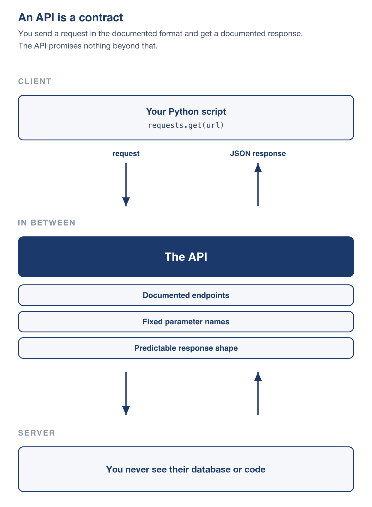
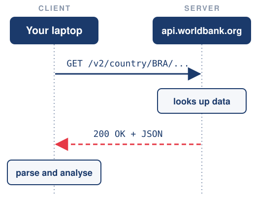

# Hey, there! 😊 <br> I hope you're all doing well! {background-color="#1B3A6B"}

# Brief recap 📚 {background-color="#1B3A6B"}

## Lecture 17: a machine in the cloud
### What we did on AWS

:::{style="margin-top: 30px; font-size: 24px;"}
:::{.columns}
::::{.column width="55%"}
- Launched an EC2 [`t3.micro`]{.alert} running Ubuntu 26.04
- Connected with a [key pair]{.alert} and `ssh -i`
- Installed software with `apt`
- Moved files with `scp` and `wget`
- Checked the instance details in the [AWS Console]{.alert}
- Met [AWS CloudShell]{.alert}, the browser terminal
- Queried AWS with the [`aws`]{.alert} command line
- Stopping pauses compute, but the disk still charges. [Terminating deletes the machine]{.alert}
::::

::::{.column width="45%"}
:::{style="text-align: center; margin-top: -20px;"}
[{width="100%"}](#){data-modal-type="image" data-modal-url="figures/aws-logo.jpeg"}

Source: [K21](https://k21academy.com/aws-cloud/overview-of-amazon-web-services-concepts/)
:::
::::
:::
:::

## Check your AWS account!
### Confirm that the bill reads zero

:::{style="margin-top: 30px; font-size: 23px;"}
:::{.columns}
:::{.column width="42%"}
- Check that no instance is still running
- [Terminate your EC2 instances](https://docs.aws.amazon.com/AWSEC2/latest/UserGuide/terminating-instances.html) and [delete your S3 buckets](https://docs.aws.amazon.com/AmazonS3/latest/userguide/delete-bucket.html)
- Open the [Billing and Cost Management Dashboard](https://console.aws.amazon.com/billing/home?#/). The total should be zero
- Charged by mistake? Ask for a refund:
  - Open the [AWS Support Center](https://console.aws.amazon.com/support/home) and click `Create case`
  - Choose `Account and billing support` and explain what happened
  - Replies are usually quick. Email me if you get stuck
:::

:::{.column width="58%"}
:::{style="text-align: center; margin-top: -20px;"}
[{width="100%"}](#){data-modal-type="image" data-modal-url="figures/aws-billing.png"}

Billing and Cost Management Home
:::
:::
:::
:::

## The final project
### A quick reminder

:::{style="margin-top: 30px; font-size: 26px;"}
- Groups of [four to five]{.alert}. Email me the names by [Thursday 5 November]{.alert}, or I assign you at random 😉
- Due [Tuesday 8 December]{.alert}. Send the repository link on Canvas
- Today's lecture covers the first step: pulling data from a [web API]{.alert}
- [Instructions](https://github.com/danilofreire/datasci350/blob/main/project/project-instructions.pdf) and [starter repository](https://github.com/danilofreire/datasci350-project-starter)
:::

# Today's lecture 📚 {background-color="#1B3A6B"}

## You have already used an API

:::{style="margin-top: 30px; font-size: 24px;"}
:::{.columns}
::::{.column width="45%"}
- In [Lecture 14](https://danilofreire.github.io/datasci350/lectures/lecture-14/14-ai.html), we saved an API key in a `.env` file
- We used it to send prompts to a model on OpenRouter and get a reply
- That exchange was an [API call]{.alert}
- The `openai` library sent the request for us. [Today we write the requests ourselves]{.alert}
- Other APIs give you weather, economic data, census records and more
::::

::::{.column width="55%"}
:::{style="margin-top: 20px; font-size: 22px;"}
```python
# Lecture 14
client = OpenAI(
    base_url="https://openrouter.ai/api/v1",
    api_key=os.environ["OPENROUTER_API_KEY"],
)

response = client.chat.completions.create(
    model="google/gemma-4-31b-it:free",
    messages=[{"role": "user", "content": "Hi!"}],
)
print(response.choices[0].message.content)
```

`base_url` is a web address, and the library sends our request there. Today you will see the request and the reply
:::
::::
:::
:::

## Lecture overview
### What we will cover today

:::{style="margin-top: 20px; font-size: 24px;"}
:::{.columns}
::::{.column width="50%"}
[1. What an API is]{.alert}

- A contract between two programs
- The client and the server
- Why data scientists care

[2. URLs and status codes]{.alert}

- The parts of a URL, and building one step by step
- The codes a server sends back
::::

::::{.column width="50%"}
[3. JSON]{.alert}

- The format almost every API uses
- How to find one value inside a nested reply

[4. APIs from the terminal]{.alert}

- `curl`, a browser for your terminal
- Saving a reply to a file

[5. A first taste of Python]{.alert}

- A few lines that do what `curl` did. Lecture 19 takes them apart
::::
:::
:::

# What is an API? {background-color="#1B3A6B"}

## An API is a contract

:::{style="margin-top: 40px; font-size: 24px;"}
:::{.columns}
::::{.column width="45%"}
- As we have seen before, [API]{.alert} stands for [Application Programming Interface](https://en.wikipedia.org/wiki/Application_programming_interface)
- It is a [contract between two programs]{.alert}
- For example, [the World Bank API](https://datahelpdesk.worldbank.org/knowledgebase/topics/125589-developer-information) turns a URL ending in `/country/BRA/indicator/SP.POP.TOTL` into [Brazil's population, year by year](https://api.worldbank.org/v2/country/BRA/indicator/SP.POP.TOTL?format=json)
- Neither side needs to know how the other works inside
- Their database, language, and servers are [none of your business]{.alert} 😂
::::

::::{.column width="55%"}
:::{style="text-align: center; margin-top: -30px;"}
[{width="65%"}](#){data-modal-type="image" data-modal-url="figures/api-contract-diagram-vertical.png"}
:::
::::
:::
:::

## Client and server

:::{style="margin-top: 40px; font-size: 27px;"}
:::{.columns}
::::{.column width="55%"}
- You have played [both roles]{.alert} this semester
- The [client]{.alert} asks: your laptop, script, or browser
- The [server]{.alert} answers: a machine in a data centre, waiting for requests
- Last class you [launched a server]{.alert} on [EC2](https://aws.amazon.com/ec2/)
- The [World Bank API](https://datahelpdesk.worldbank.org/knowledgebase/articles/889392-about-the-indicators-api-documentation) is the same idea, with a bigger budget and (hopefully!) better uptime 😂
- There is nothing magical about it. [It is someone else's computer](https://aws.amazon.com/ec2/) 🤓
::::

::::{.column width="45%"}
:::{style="margin-top: 10px;"}
[{width="100%"}](#){data-modal-type="image" data-modal-url="figures/client-server.svg"}
:::
::::
:::
:::

## What makes an API a web API

:::{style="margin-top: 40px; font-size: 24px;"}
- "API" is a broad word. `pandas` has an API, and so does your operating system
- We focus on [web APIs](https://en.wikipedia.org/wiki/Web_API):
  - The request is an [HTTP request to a URL]{.alert}, like the ones your browser sends
  - The response is usually [JSON]{.alert}, a text format we cover shortly
- So you can use them from [any language that fetches URLs]{.alert}: Python, R, JavaScript, or `curl`
- Terms you will see in documentation:
  - [REST (Representational State Transfer)](https://en.wikipedia.org/wiki/Representational_State_Transfer): each URL names a resource, such as `/country/BRA`. Most public data APIs use it
  - [Endpoint](https://en.wikipedia.org/wiki/Web_API#Endpoints): one URL pattern the API offers, such as `/v2/country/{code}/indicator/{code}`
  - [Rate limit](https://en.wikipedia.org/wiki/Rate_limiting): how many requests you may send per unit of time
:::

## Why this matters for data science

:::{style="margin-top: 20px; font-size: 24px;"}
:::{.columns}
::::{.column width="50%"}
#### The data are already out there

- Many organisations share data through APIs:
  - [The World Bank](https://datahelpdesk.worldbank.org/knowledgebase/topics/125589-developer-information), [the IMF](https://data.imf.org/en/Resource-Pages/IMF-API), [the US Census Bureau](https://www.census.gov/data/developers/data-sets.html), [the ECB](https://data.ecb.europa.eu/help/api/overview), [Eurostat](https://ec.europa.eu/eurostat/web/main/data/web-services)
  - [GitHub](https://docs.github.com/en/rest), [Wikipedia](https://www.mediawiki.org/wiki/API:Main_page), and [Emory's course catalogue (Atlas)](https://atlas.emory.edu/)
  - Most national statistics offices
- The [World Bank API](https://api.worldbank.org/v2/indicator?format=json) alone has [~16,000 indicators]{.alert} for over 200 countries
- Most of these data are free
::::

::::{.column width="50%"}
#### A script instead of a download button

- The [URL is the query]{.alert}: [GDP per capita, Brazil and Argentina, 2000 to 2023](https://api.worldbank.org/v2/country/BRA;ARG/indicator/NY.GDP.PCAP.CD?date=2000:2023&format=json)

:::{style="font-size: 27px;"}
```text
api.worldbank.org/v2/country/BRA;ARG/
  indicator/NY.GDP.PCAP.CD
  ?date=2000:2023
```
:::

- A CSV does not record what you selected
- Data get [revised]{.alert}. Rerun the script for the latest figures
- Save a dated copy in `data/raw/`
- A short loop can fetch data for all 200+ countries
::::
:::
:::

## Three kinds of API
### Some are open, some need a key, and some charge you

:::{style="margin-top: 30px; font-size: 21px;"}
:::{.columns}
::::{.column width="60%"}
| Kind | What it costs you | Examples |
|---|---|---|
| [Open and keyless]{.alert} | Nothing. Just fetch the URL | [Open-Meteo](https://open-meteo.com/), [World Bank](https://data.worldbank.org/), [National Weather Service](https://www.weather.gov/documentation/services-web-api), [USGS earthquakes](https://earthquake.usgs.gov/fdsnws/event/1/), [GitHub](https://docs.github.com/en/rest) |
| [Free but key-required]{.alert} | A signup form, then a key in every request | [NASA](https://api.nasa.gov/), [OpenWeatherMap](https://openweathermap.org/api), [OpenRouter](https://openrouter.ai/)'s free models, [GitHub](https://docs.github.com/en/rest/authentication/authenticating-to-the-rest-api) for higher limits |
| [Paid]{.alert} | A key and a bill | [OpenRouter](https://openrouter.ai/models)'s paid models, most commercial data vendors |

:::{style="margin-top: 30px;"}
- An [API key]{.alert} is a password for programs. It tells the server who is asking
- [GitHub answers keyless requests](https://docs.github.com/en/rest/using-the-rest-api/rate-limits-for-the-rest-api), up to [60 per hour per IP address]{.alert}
- Today we stay in the first row, so nobody needs an account
:::
::::

::::{.column width="40%"}
:::{style="text-align: center;"}
[{width="100%"}](#){data-modal-type="image" data-modal-url="figures/github-api-2026.png"}

:::{style="font-size: 19px;"}
[`api.github.com/users/danilofreire`](https://api.github.com/users/danilofreire), fetched with no key at all (click image to enlarge)
:::
:::
::::
:::
:::

# URLs and status codes 🔗 {background-color="#1B3A6B"}

## Anatomy of a URL
### Four parts you will see in every request

:::{style="margin-top: 30px; font-size: 25px;"}
- Every API call starts with a URL, and every URL has the same parts
- [Here is a real one](https://api.worldbank.org/v2/country/BRA/indicator/NY.GDP.PCAP.KD?format=json&date=2014:2025): Brazil's GDP per person, 2014 to 2025

:::{style="margin-top: 25px; text-align: center; font-size: 26px; font-family: monospace; line-height: 1.8;"}
[https]{style="color: #1B3A6B; font-weight: bold;"}[://]{style="color: #999;"}[api.worldbank.org]{style="color: #C1272D; font-weight: bold;"}[/v2/country/BRA/indicator/NY.GDP.PCAP.KD]{style="color: #2E7D32; font-weight: bold;"}[?]{style="color: #999;"}[format=json&date=2014:2025]{style="color: #E65100; font-weight: bold;"}
:::

:::{style="margin-top: 30px; font-size: 26px;"}
| Part | Name | What it does |
|---|---|---|
| [https]{style="color: #1B3A6B; font-weight: bold;"} | scheme | Which protocol. Almost always `https` |
| [api.worldbank.org]{style="color: #C1272D; font-weight: bold;"} | host | Which machine to ask |
| [/v2/country/BRA/indicator/...]{style="color: #2E7D32; font-weight: bold;"} | path | Which data on that machine |
| [?]{style="color: #999; font-weight: bold;"} | separator | Ends the path. Everything after it is the query string |
| [format=json&date=2014:2025]{style="color: #E65100; font-weight: bold;"} | query string | Options, as `key=value` pairs joined by `&` |
:::
:::

## Building a URL

:::{style="margin-top: 40px; font-size: 24px;"}
:::{.columns}
::::{.column width="60%"}
| Step | Add this | What it means |
|---|---|---|
| 1 | `https://api.worldbank.org/v2` | The API's [base URL]{.alert}, version 2 |
| 2 | `/country/BRA` | Brazil, by its [three-letter ISO code](https://en.wikipedia.org/wiki/ISO_3166-1_alpha-3#Officially_assigned_code_elements) |
| 3 | `/indicator/NY.GDP.PCAP.KD` | GDP per person, in constant US dollars |
| 4 | `?format=json` | Start the options. Send JSON, not XML |
| 5 | `&date=2014:2025` | Only these years |

- The [path]{.alert} (steps 1 to 3) says [what]{.alert} you want
- The [query string]{.alert} (steps 4 and 5) says [how]{.alert} you want it
::::

::::{.column width="40%"}
- Swap `BRA` for `URY` and you get Uruguay
- Swap the indicator for `SP.POP.TOTL` and you get population
- Indicator codes are listed at [data.worldbank.org/indicator](https://data.worldbank.org/indicator)
- In `NY.GDP.PCAP.KD`:
  - `NY` = national accounts (income)
  - `GDP` = gross domestic product
  - `PCAP` = per capita
  - `KD` = constant US dollars
::::
:::
:::

## Reading the query string {#sec:query-string}
### Everything after the question mark

:::{style="margin-top: 40px; font-size: 25px;"}
:::{.columns}
::::{.column width="55%"}
- The query string starts at the [`?`]{.alert}
- Each option is `key=value`, and [`&`]{.alert} joins them

:::{style="margin-left: 50px;"}
```
?format=json&date=2014:2025&per_page=100
 ^^^^^^^^^^^ ^^^^^^^^^^^^^^ ^^^^^^^^^^^^
 option 1    option 2       option 3
```
:::

- [Order does not matter]{.alert}: `?a=1&b=2` and `?b=2&a=1` are the same request
- Leave out an option and the API uses its [default]{.alert}
- Misspell a key and the API usually [ignores it]{.alert} without telling you
::::

::::{.column width="45%"}
- Some characters already have a job in a URL: `?`, `&`, `=`, `#`, and the space
- To put one inside a value, you [percent-encode]{.alert} it
- A space becomes `%20`, and a `/` becomes `%2F`
- So `America/New_York` travels as `America%2FNew_York`
- Python's `requests` library does this for you, so you rarely type it
- The full table is in [Appendix 04](#sec:appendix04)
::::
:::
:::

## Status codes

:::{style="margin-top: 40px; font-size: 23px;"}
- Every response carries a [three-digit number](https://developer.mozilla.org/en-US/docs/Web/HTTP/Status) saying how it went
- The first digit sums it up: [`2xx` worked, `4xx` is your mistake, `5xx` is theirs]{.alert}

:::{style="font-size: 22px;"}
| Code | Name | What it means |
|---|---|---|
| [`200`]{style="color: #2E7D32; font-weight: bold;"} | OK | It worked. Go ahead and read the data |
| `301` / `302` | Moved | The data lives elsewhere now. Browsers and `requests` follow these for you |
| [`400`]{style="color: #E65100; font-weight: bold;"} | Bad Request | Your URL is malformed. Check the query string |
| [`401`]{style="color: #E65100; font-weight: bold;"} | Unauthorized | You need a key, or yours is wrong |
| [`403`]{style="color: #E65100; font-weight: bold;"} | Forbidden | Your key works, but it does not give you access to this |
| [`404`]{style="color: #E65100; font-weight: bold;"} | Not Found | Nothing at that path. Usually a typo |
| [`429`]{style="color: #C1272D; font-weight: bold;"} | Too Many Requests | You are asking too fast. Slow down |
| [`500`]{style="color: #C1272D; font-weight: bold;"} | Internal Server Error | Their problem. Wait and retry |
:::

:::{style="margin-top: 15px; background: rgba(230, 57, 70, 0.1); padding: 15px; border-radius: 10px; font-size: 19px;"}
Some APIs, like the World Bank, answer errors with [`200`]{.alert} and hide the failure in the reply. A status check alone is not enough. We will see this in the terminal soon
:::
:::

## GET and POST
### Two main verbs

:::{style="margin-top: 40px; font-size: 24px;"}
:::{.columns}
::::{.column width="50%"}
#### `GET`: "please send me this"

- Asks for data and changes nothing
- The whole request fits in the URL
- Your browser sends one for every page you visit
- Safe to repeat: fetching twice changes nothing on the server
- [About 95% of what you will do in this course]{.alert}
:::

::::{.column width="50%"}
#### `POST`: "here is some data"

- Sends data to the server
- The data travels in the request [body]{.alert}, not the URL
- Used for logins, uploads, and long inputs
- In Lecture 14, the `openai` library sent your prompt as a `POST`
- A paragraph of text does not belong in a URL
:::
:::

:::{style="margin-top: 25px;"}
[Other methods](https://developer.mozilla.org/en-US/docs/Web/HTTP/Reference/Methods) exist (`PUT`, `DELETE`, `PATCH`), but you rarely need them to read public data
:::
:::

## Try it in the browser first
### The address bar is an HTTP client you already know

:::{style="margin-top: 40px; font-size: 24px;"}
:::{.columns}
::::{.column width="45%"}
- Before writing any code, [paste the URL into your browser]{.alert} ([try this one](https://api.open-meteo.com/v1/forecast/?latitude=33.75&longitude=-84.39&current=temperature_2m))
- The browser sends a `GET` and shows the raw reply
- [JSON on screen]{.alert}: the URL is right. If your code fails later, the problem is in the code
- [An error on screen]{.alert}: the URL is wrong
- It's a good habit to check the URL in the browser before writing code! 😉
:::

::::{.column width="55%"}
:::{style="text-align: center;"}
[{width="100%"}](#){data-modal-type="image" data-modal-url="figures/openmeteo-browser-2026.png"}

:::{style="font-size: 20px;"}
Open-Meteo answering a plain `GET` from the address bar, no code involved
:::
:::
::::
:::
:::

## Try it yourself! 🤓 {#sec:exercise01}
### Build a URL by hand in your browser

:::{style="margin-top: 40px; font-size: 24px;"}
:::{.columns}
::::{.column width="55%"}
1. Open the [Open-Meteo docs](https://open-meteo.com/en/docs#api_documentation) and start from `https://api.open-meteo.com/v1/forecast`
2. Ask for the [current temperature]{.alert} (`current=temperature_2m`) in Atlanta (latitude `33.75`, longitude `-84.39`). You need three parameters
3. [Write the query string yourself]{.alert}. Do not copy it from the docs
4. Paste the URL into the address bar and press Enter
5. Delete `longitude`. What happens?
6. To covert the temperature to Fahrenheit, add `&temperature_unit=fahrenheit` to the URL
::::

::::{.column width="45%"}
:::{style="margin-top: -15px;"}
[What to look for]{.alert}

- A temperature and its units in the JSON
- A different number for the other city
- An error message without `longitude`

:::{style="margin-top: 25px; background: rgba(27, 58, 107, 0.08); padding: 15px; border-radius: 10px; font-size: 20px;"}
Stuck, or want to compare your URL with mine?

[[Appendix 01]{.button}](#sec:appendix01)
:::
:::
::::
:::
:::

# JSON 📦 {background-color="#1B3A6B"}

## What JSON is

:::{style="margin-top: 40px; font-size: 22px;"}
:::{.columns}
::::{.column width="50%"}
- [JSON]{.alert} means [JavaScript Object Notation](https://en.wikipedia.org/wiki/JSON). The name records its origin, [not where it is used today](https://www.geeksforgeeks.org/javascript/json-vs-javascript-object/)
- It is [plain text]{.alert}, so any editor opens it
- Almost every web API uses it, because [every language can read it]{.alert}
- It holds [data only]{.alert}: no code, functions, or classes
- Two building blocks, nested as deep as needed:
  - An [object]{.alert} `{ }` holds `"key": value` pairs
  - An [array]{.alert} `[ ]` holds values in order

```json
{
  "city": "Atlanta",
  "temperature": 29.6,
  "raining": false,
  "sensors": ["a1", "b2"],
  "last_checked": null
}
```
::::

::::{.column width="50%"}
:::{style="margin-top: -15px;"}
Each JSON type has a Python equivalent

| JSON | Python |
|---|---|
| `{...}` object | `dict` (dictionary) |
| `[...]` array | `list` |
| `"text"` | `str` (string) |
| `42`, `3.14` | `int`, `float` |
| `true` / `false` | `True` / `False` |
| `null` | `None` |

:::{style="margin-top: 20px;"}
- Keys are [always text in double quotes]{.alert}
- No comma after the last item
- In the example, `"sensors"` is an array inside an object
:::
:::
::::
:::
:::

## A real reply

:::{style="margin-top: 40px; font-size: 24px;"}
:::{.columns}
::::{.column width="52%"}
:::{style="font-size: 20px;"}
```json
{
  "latitude": 33.759865,
  "longitude": -84.39586,
  "timezone": "America/New_York",
  "elevation": 316.0,
  "current_units": {
    "time": "iso8601",
    "temperature_2m": "°C",
    "wind_speed_10m": "km/h"
  },
  "current": {
    "time": "2026-08-21T16:00",
    "temperature_2m": 33.2,
    "wind_speed_10m": 4.4
  }
}
```
:::

:::{style="font-size: 17px;"}
Shortened from the saved reply, [`openmeteo_atlanta.json`](https://github.com/danilofreire/datasci350/blob/main/lectures/lecture-18/data/openmeteo_atlanta.json)
:::
::::

::::{.column width="48%"}
- The outer `{ }` is an object. It has nine keys, and six are shown here
- Two of them, [`current`]{.alert} and [`current_units`]{.alert}, hold [objects of their own]{.alert}
- That is what "nested" means: a box inside a box
- The temperature is inside `current`. Its unit is inside `current_units`
- `time` is text, because JSON has no date type
::::
:::
:::

## Finding a value: follow the path

:::{style="margin-top: 40px; font-size: 24px;"}
:::{.columns}
::::{.column width="45%"}
- A [path]{.alert} lists the steps to a value, from the outside in
- In an [object]{.alert}, each step is a [key name]{.alert}
- In an [array]{.alert}, each step is a [position]{.alert}, starting at 0, as in Python
- In Python, each step becomes a pair of [square brackets]{.alert}
- Get the path right first
::::

::::{.column width="55%"}
:::{style="font-size: 24px; margin-top: -20px;"}
Two replies: the Open-Meteo one, and `{"sensors": ["a1", "b2"]}`

:::{style="font-size: 30px; margin: 10px 0 20px 0;"}
| Path | Value |
|---|---|
| `current` → `temperature_2m` | [33.2]{.alert} |
| `current_units` → `temperature_2m` | [°C]{.alert} |
| `sensors` → `0` | ["a1"]{.alert} |
| `sensors` → `1` | ["b2"]{.alert} |

: {tbl-colwidths="[75,25]"}
:::

The same paths in Python:

:::{style="font-size: 28px;"}
```python
data["current"]["temperature_2m"]   # 33.2
data["sensors"][0]                  # "a1"
```
:::
:::
::::
:::
:::

## The World Bank reply {#sec:wb-reply}
### An array with metadata, then data

:::{style="margin-top: 40px; font-size: 22px;"}
:::{.columns}
::::{.column width="50%"}
- The reply is an [array]{.alert} with two items
- [Position 0]{.alert}: metadata about the request
- [Position 1]{.alert}: the data, one object per year, newest first

:::{style="font-size: 22px;"}
```json
[
  {"page": 1, "pages": 1, "total": 12, ...},
  [
    {"country": {"id": "BR", "value": "Brazil"},
     "date": "2025", "value": 9747.99557762692},
    ... 11 more years
  ]
]
```
:::

:::{style="font-size: 17px;"}
Shortened from [`wb_gdp_bra.json`](https://github.com/danilofreire/datasci350/blob/main/lectures/lecture-18/data/wb_gdp_bra.json), the reply to our Brazil URL
:::
::::

::::{.column width="50%"}
:::{style="font-size: 24px;"}
```python
import json
data = json.load(open("wb_gdp_bra.json"))

data[0]["total"]                 # 12
data[1][0]["date"]               # "2025"
data[1][0]["value"]              # 9747.99...
data[1][0]["country"]["value"]   # "Brazil"
```
:::

- Every path starts with a [position]{.alert}, because the reply is an array
- A [number]{.alert} picks an item from a `[ ]`, a [name]{.alert} picks one from a `{ }`
- Look at the shape [before]{.alert} you write any code

:::{style="margin-top: 20px; background: rgba(27, 58, 107, 0.08); padding: 15px; border-radius: 10px; font-size: 20px;"}
More about the World Bank API reply, and its [official documentation](https://datahelpdesk.worldbank.org/knowledgebase/topics/125589-developer-information): [[Appendix 07]{.button}](#sec:appendix07)
:::
::::
:::
:::

## Try it yourself! 🤓 {#sec:exercise02}
### Write the paths in Python

:::{style="margin-top: 40px; font-size: 24px;"}
:::{.columns}
::::{.column width="55%"}
:::{style="font-size: 22px;"}
```python
import json

text = """
{"term": "Fall 2026",
 "courses": [
   {"code": "DATASCI 350", "enrolled": 40,
    "instructor": {"name": "Danilo Freire"}},
   {"code": "DATASCI 101", "enrolled": 65,
    "instructor": {"name": "Danilo Freire"}}],
 "updated": null}
"""
reply = json.loads(text)

print(reply["term"])   # Fall 2026
```
:::
::::

::::{.column width="45%"}
1. Copy the code into a notebook or a `.py` file and run it
2. Print the [code of the second course]{.alert}
3. Print the [name of the first course's instructor]{.alert}
4. Print `reply["updated"]`. What do you see, and why?

:::{style="margin-top: 20px; background: rgba(27, 58, 107, 0.08); padding: 15px; border-radius: 10px; font-size: 20px;"}
Stuck, or want to compare your paths with mine?

[[Appendix 02]{.button}](#sec:appendix02)
:::
::::
:::
:::

# APIs from the terminal 💻 {background-color="#1B3A6B"}

## `curl`: a browser for your terminal

:::{style="margin-top: 40px; font-size: 24px;"}
- `curl` sends a `GET` to a URL and prints the reply, as one long line
- It comes with macOS, Linux and WSL. Missing in WSL? Run `sudo apt install curl`
- [Put the URL in double quotes]{.alert}. Otherwise the shell reads `&` and `?` as its own symbols

```{=html}
<style>.wrapcode pre code { white-space: pre-wrap !important; word-break: break-all; }</style>
```

:::{.wrapcode style="font-size: 32px; margin-top: 15px;"}
```{.bash code-line-numbers="false"}
curl "https://api.open-meteo.com/v1/forecast?latitude=33.75&longitude=-84.39&current=temperature_2m"
```
:::

- That is hard to read and easy to mistype. Split it into pieces:
  - `BASE=` stores the base URL, and `Q=` the query string
  - `$BASE` and `$Q` paste them back

:::{style="font-size: 32px;"}
```bash
BASE="https://api.open-meteo.com/v1/forecast"
Q="latitude=33.75&longitude=-84.39&current=temperature_2m"
curl "$BASE?$Q"
```
:::
:::

## Readable replies and status codes {#sec:readable-replies}

:::{style="margin-top: 40px; font-size: 23px;"}
:::{.columns}
::::{.column width="50%"}
- Pipe (`|`) the reply into Python's JSON tool to indent it
- `-s` means "silent": no progress bar

:::{style="font-size: 24px;"}
```bash
curl -s "$BASE?$Q" | python3 -m json.tool
```

```text
{
    "latitude": 33.759865,
    ...
    "current": {
        "time": "2026-10-26T16:15",
        "interval": 900,
        "temperature_2m": 18.9
    }
}
```
:::
::::

::::{.column width="50%"}
- `-i` adds the [headers]{.alert} ([Appendix 05](#sec:appendix05)). The first line is the [status]{.alert}
- `| head -n 1` keeps only that line

:::{style="font-size: 24px;"}
```bash
curl -si "$BASE?$Q" | head -n 1
```

```text
HTTP/1.1 200 OK
```

Without `longitude`:

```bash
curl -si "$BASE?latitude=33.75" | head -n 1
```

```text
HTTP/1.1 400 Bad Request
```
:::

:::{style="margin-top: 15px; background: rgba(230, 57, 70, 0.1); padding: 15px; border-radius: 10px; font-size: 20px;"}
The World Bank answers [`200`]{.alert} even for a country that does not exist (`XYZ`), and puts the error inside the JSON. Check the status [and]{.alert} the data
:::
::::
:::
:::

## Saving a reply to a file

:::{style="margin-top: 40px; font-size: 24px;"}
- `-o` means "output": save the reply to a file instead of printing it

:::{style="font-size: 30px; margin-top: 20px; margin-bottom: 20px;"}
```bash
BASE="https://api.worldbank.org/v2/country/BRA/indicator/NY.GDP.PCAP.KD"
Q="format=json&date=2014:2025&per_page=100"
curl -s -o wb_gdp_bra.json "$BASE?$Q"
ls -lh wb_gdp_bra.json                              # 2.7K
python3 -m json.tool wb_gdp_bra.json | head -n 12   # first 12 lines
```
:::

- A saved file [does not change]{.alert}. The live API does
- Your analysis then runs offline and gives the same numbers every time
- The files in this lecture's [`data/`](https://github.com/danilofreire/datasci350/tree/main/lectures/lecture-18/data) folder were made this way
- Your project does the same: save a snapshot in `data/raw/`, and read only that file
- In Lecture 19 we do it in Python
:::

## Try it yourself! 🤓 {#sec:exercise03}
### Uruguay's population, from the terminal

:::{style="margin-top: 20px; font-size: 24px;"}
1. Type these four lines:

:::{style="font-size: 26px;"}
```bash
BASE="https://api.worldbank.org/v2/country/URY/indicator/SP.POP.TOTL"
Q="format=json&date=2014:2025"
curl -s -o wb_pop_ury.json "$BASE?$Q"
python3 -m json.tool wb_pop_ury.json
```
:::

:::{.columns}
::::{.column width="50%"}
2. Scroll the output and find the population in [2020]{.alert}
3. Bonus: now print the population in [2020]{.alert} from Python

[What to look for]{.alert}

- Twelve records, newest first
- About 3.4 million people
::::

::::{.column width="50%"}
:::{style="margin-top: -20px;"}
[Hint for step 3]{.alert}

- Start Python in the folder where you ran `curl`, then load the file:

:::{style="font-size: 22px;"}
```python
import json
data = json.load(open("wb_pop_ury.json"))
```
:::

- The records are in position `1`, newest first

:::{style="background: rgba(27, 58, 107, 0.08); padding: 15px; border-radius: 10px; font-size: 20px;"}
Stuck, or want to compare with mine? [[Appendix 03]{.button}](#sec:appendix03)
:::
:::
::::
:::
:::

# A first taste of Python 🐍 {background-color="#1B3A6B"}

## A few lines of Python
### The same request, from a script

:::{style="margin-top: 20px; font-size: 24px;"}
- [`requests`](https://github.com/psf/requests) is the Python library for web APIs. Install it once: `pip install requests`

:::{style="font-size: 30px;"}
```python
import requests

base = "https://api.open-meteo.com/v1/forecast"
q = "latitude=33.75&longitude=-84.39&current=temperature_2m"

r = requests.get(base + "?" + q)          # send a GET, like curl
print(r.status_code)                      # 200 means OK

data = r.json()                           # JSON text -> Python dictionary
print(data["current"]["temperature_2m"])  # the path, one [] per step
```

```text
200
19.2
```
:::
:::

# Conclusion 📚 {background-color="#1B3A6B"}

## What we learned today

:::{style="margin-top: 30px; font-size: 27px;"}
:::{.columns}
::::{.column width="50%"}
#### Concepts

- An [API]{.alert} is a contract: ask this way, get that back
- A [URL]{.alert} has a path (what) and a [query string]{.alert} (how)
- A [status code]{.alert} says how it went: `2xx`, `4xx`, `5xx`
- [JSON]{.alert} values are reached by a [path]{.alert} of keys and positions
::::

::::{.column width="50%"}
#### Good habits

- Test the URL in your browser first
- Quote URLs in the terminal
- Check the status [and]{.alert} the data
- Save a copy, then work from the file
::::
:::
:::

## Next class {#sec:next-class}

:::{style="margin-top: 40px; font-size: 24px;"}
:::{.columns}
::::{.column width="55%"}
- Next class we do all of this in Python
- Reading JSON from a reply and from a file
- Building requests with `params`, and checking them for errors
- From the World Bank reply to a pandas DataFrame
- Your project's pull script, line by line
::::

::::{.column width="45%"}
:::{style="text-align: center; margin-top: -20px;"}
[Before then]{.alert}

1. Install the packages you will need next class (see below)
2. Check that your AWS bill reads zero
3. Read the project instructions and form a group of four to five
4. Finish Exercise 03 if you did not have time in class

```bash
pip install requests pandas pyarrow
```

:::{style="margin-top: 10px; font-size: 20px;"}
A list of keyless APIs to explore is in [Appendix 06](#sec:appendix06)
:::

:::{style="margin-top: 15px; font-size: 20px;"}
Group names are due by [Thursday 5 November]{.alert}
:::
:::
::::
:::
:::

# And that's all for today! 😊 {background-color="#1B3A6B"}

## Appendix 01 {#sec:appendix01}
### Exercise 01 solution

:::{style="margin-top: 20px; font-size: 22px;"}
:::{.columns}
::::{.column width="55%"}
Open-Meteo needs `latitude` and `longitude`, and `current` asks for present conditions

```
https://api.open-meteo.com/v1/forecast?latitude=33.75
&longitude=-84.39&current=temperature_2m
```

Adding a timezone makes the time readable:

```
https://api.open-meteo.com/v1/forecast?latitude=33.75
&longitude=-84.39&current=temperature_2m
&timezone=America%2FNew_York
```

Without `longitude`, the page shows:

```text
{"error":true,"reason":"Parameter 'latitude' and
'longitude' must have the same number of elements"}
```
::::

::::{.column width="45%"}
- Both coordinates are required. The request fails without either one
- The `/` in the timezone is written `%2F`, because `/` already has a job in a URL
- Without `timezone`, the time comes back in GMT, which reads oddly for Atlanta
- The reading is live, so your number will differ from mine

:::{style="margin-top: 25px; background: rgba(27, 58, 107, 0.08); padding: 15px; border-radius: 10px; font-size: 20px;"}
[[Back to exercise]{.button}](#sec:exercise01)
:::
::::
:::
:::

## Appendix 02 {#sec:appendix02}
### Exercise 02 solution

:::{style="margin-top: 20px; font-size: 24px;"}
:::{.columns}
::::{.column width="55%"}
1. `courses` → `1` → `code` → "DATASCI 101"
2. `courses` → `0` → `instructor` → `name` → "Danilo Freire"
3. `updated` → `null`, which becomes `None` in Python

The same paths in Python:

```python
print(reply["courses"][1]["code"])                  # DATASCI 101
print(reply["courses"][0]["instructor"]["name"])    # Danilo Freire
print(reply["updated"])                             # None
```
::::

::::{.column width="45%"}
- `courses` is an array, so the second course is position [`1`]{.alert}, not 2
- The name is four steps down: `courses`, then the course, then `instructor`, then `name`
- `null` is JSON's word for "no value". It is not the text `"null"`

:::{style="margin-top: 25px; background: rgba(27, 58, 107, 0.08); padding: 15px; border-radius: 10px; font-size: 20px;"}
[[Back to exercise]{.button}](#sec:exercise02)
:::
::::
:::
:::

## Appendix 03 {#sec:appendix03}
### Exercise 03 solution

:::{style="margin-top: 20px; font-size: 19px;"}
:::{.columns}
::::{.column width="55%"}
Part of the output, around 2020:

```text
        {
            ...
            "countryiso3code": "URY",
            "date": "2020",
            "value": 3398968,
            ...
        },
```

- The 2020 population is [3,398,968]{.alert}
- Its path: `1` → `5` → `value`. Records run newest first, so 2025 is position `0` and 2020 is position `5`

Step 3, in Python:

```python
import json
data = json.load(open("wb_pop_ury.json"))
print(data[1][5]["value"])   # 3398968
```

- `[1]` is the list of records, `[5]` the 2020 record, and `["value"]` its population
::::

::::{.column width="45%"}
- Only the country and the indicator differ from the Brazil example
- The saved file is also in [`data/wb_pop_ury.json`](https://github.com/danilofreire/datasci350/blob/main/lectures/lecture-18/data/wb_pop_ury.json)

[Got a `FileNotFoundError`?]{.alert}

- `open` looks in the folder where you started Python, and it does not understand `~`
- Use `pwd` and `ls` to find the file, then `cd` there before `python3`
- Or give the full path: `open("/Users/yourname/wb_pop_ury.json")`

:::{style="margin-top: 20px; background: rgba(27, 58, 107, 0.08); padding: 15px; border-radius: 10px; font-size: 20px;"}
[[Back to exercise]{.button}](#sec:exercise03)
:::
::::
:::
:::

## Appendix 04: percent-encoding {#sec:appendix04}
### Characters that need a code inside a value

:::{style="margin-top: 20px; font-size: 22px;"}
:::{.columns}
::::{.column width="50%"}
:::{style="margin-top: 40px; text-align: center; font-size: 25px;"}
| You write | It travels as |
|---|---|
| space | `%20` or `+` |
| `/` | `%2F` |
| `?` | `%3F` |
| `&` | `%26` |
| `=` | `%3D` |
| `:` | `%3A` |
| `#` | `%23` |
| `%` | `%25` |
:::
::::

::::{.column width="50%"}
:::{style="margin-top: 40px;"}
- The pattern is [always the same]{.alert}: `%` and the character's byte in hexadecimal (remember them from Lecture 02? 😉)
- `America/New_York` becomes `America%2FNew_York`
- `requests` encodes values for you, so you rarely write these by hand
- Full tables and rules: [MDN](https://developer.mozilla.org/en-US/docs/Glossary/Percent-encoding), [W3Schools](https://www.w3schools.com/tags/ref_urlencode.asp), and [RFC 3986 §2.1](https://datatracker.ietf.org/doc/html/rfc3986#section-2.1)

:::{style="margin-top: 25px; background: rgba(27, 58, 107, 0.08); padding: 15px; border-radius: 10px; font-size: 20px;"}
[[Back to query string]{.button}](#sec:query-string)
:::
:::
::::
:::
:::

## Appendix 05: headers {#sec:appendix05}

:::{style="margin-top: 20px; font-size: 21px;"}
:::{.columns}
::::{.column width="50%"}
- Every request and every reply carries [headers]{.alert}: notes about the message itself

| Header | Purpose |
|---|---|
| [`User-Agent`]{.alert} | Who is asking. Browsers set this, and polite scripts should too |
| [`Accept`]{.alert} | What format you want back (`application/json`) |
| [`Authorization`]{.alert} | Your API key, for APIs that need one |
| `Content-Type` | The format of the data being sent |
::::

::::{.column width="50%"}
```bash
curl -sI "https://api.worldbank.org/v2/country/BRA/indicator/NY.GDP.PCAP.KD?format=json&date=2014:2025"
```

```text
HTTP/2 200
content-type: application/json;charset=utf-8
cache-control: public, max-age=86400
server: cloudflare
...
```

- `-I` asks for the headers only, without the data
- `content-type` confirms the reply is JSON
- `max-age=86400` says the reply can be reused for a day (86,400 seconds)

:::{style="margin-top: 25px; background: rgba(27, 58, 107, 0.08); padding: 15px; border-radius: 10px; font-size: 20px;"}
[[Back to the slide]{.button}](#sec:readable-replies)
:::
::::
:::
:::

## Appendix 06: free APIs worth exploring {#sec:appendix06}

:::{style="margin-top: 20px; font-size: 20px;"}
All of these answered a keyless request on 21 August 2026

| API | What it gives you | Documentation |
|---|---|---|
| [Open-Meteo]{.alert} | Weather forecasts and history, anywhere | <https://open-meteo.com/en/docs> |
| [World Bank]{.alert} | 29,544 development indicators, all countries | <https://datahelpdesk.worldbank.org/knowledgebase/topics/125589-developer-information> |
| [National Weather Service]{.alert} | US forecasts and alerts, from `api.weather.gov/points/{lat},{lon}` | <https://www.weather.gov/documentation/services-web-api> |
| [GitHub]{.alert} | Repositories, users, commits (keyless with low limits) | <https://docs.github.com/en/rest> |
| [Open Library]{.alert} | Books, authors, covers, by ISBN (occasionally flaky) | <https://openlibrary.org/developers/api> |
| [USGS Earthquakes]{.alert} | Every recorded earthquake, live | <https://earthquake.usgs.gov/fdsnws/event/1/> |

:::{style="margin-top: 20px;"}
Pick one this week and fetch something from it, in the browser or with `curl`
:::

:::{style="margin-top: 25px; background: rgba(27, 58, 107, 0.08); padding: 15px; border-radius: 10px; font-size: 20px;"}
[[Back to next class]{.button}](#sec:next-class)
:::
:::

## Appendix 07: the World Bank reply in detail {#sec:appendix07}

:::{style="margin-top: 20px; font-size: 19px;"}
:::{.columns}
::::{.column width="50%"}
[Position 0]{.alert}: the metadata

:::{style="font-size: 25px; margin: 5px 0 15px 0;"}
| Key | Meaning |
|---|---|
| `page` | Which page this is |
| `pages` | How many pages there are |
| `per_page` | Records per page: 50, unless you set `per_page` |
| `total` | Records across all pages |
| `lastupdated` | When the indicator was last updated |

: {tbl-colwidths="[30,70]"}
:::

```python
data[0]["pages"]   # 1
```

- If `pages` is above 1, you only have [part of the data]{.alert}
- Add `&page=2` to the URL, or raise `per_page`
- `country/all` for 2023 returns 266 records, so 6 pages of 50
- The 266 include regions and income groups, not only countries
- Everything else is in the [World Bank's developer documentation](https://datahelpdesk.worldbank.org/knowledgebase/topics/125589-developer-information)
::::

::::{.column width="50%"}
[Position 1]{.alert}: one full record from `wb_gdp_bra.json`

:::{style="font-size: 22px;"}
```json
{"indicator": {"id": "NY.GDP.PCAP.KD",
   "value": "GDP per capita (constant 2015 US$)"},
 "country": {"id": "BR", "value": "Brazil"},
 "countryiso3code": "BRA",
 "date": "2025",
 "value": 9747.99557762692,
 "unit": "",
 "obs_status": "",
 "decimal": 1}
```
:::

- `country.id` is the two-letter code, `countryiso3code` the three-letter one
- `date` is [text]{.alert}, and `value` is [`null`]{.alert} (Python's `None`) when a year has no data

```python
for record in data[1]:
    year = int(record["date"])         # date is text
    if record["value"] is not None:    # null becomes None
        print(year, round(record["value"]))
```

:::{style="margin-top: 15px; background: rgba(27, 58, 107, 0.08); padding: 15px; border-radius: 10px; font-size: 20px;"}
[[Back to the slide]{.button}](#sec:wb-reply)
:::
::::
:::
:::
